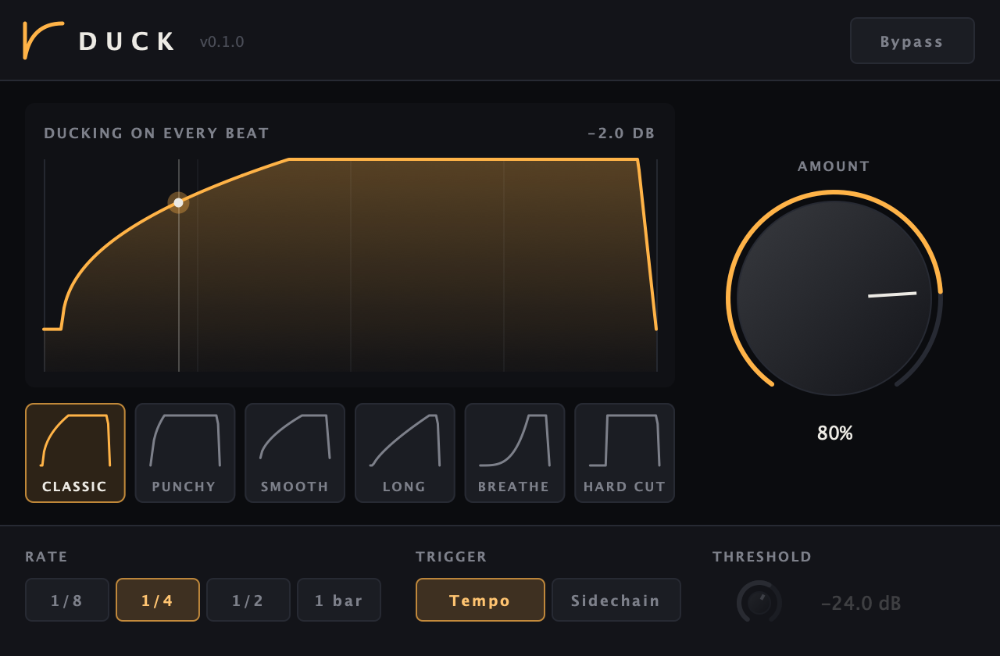

# Duck

**One-knob sidechain ducking.** Pick a shape, turn up the amount, done. Duck pumps your bass, pads or
buses in time with the beat, or ducks them from the actual kick through the sidechain input.

AU · VST3 · Standalone — macOS (Windows VST3 builds in CI) — built with [JUCE](https://juce.com)



## Features

- **Amount** — one big knob for how deep the duck goes
- **Six shapes** — Classic, Punchy, Smooth, Long, Breathe and Hard Cut
- **Rate** — 1/8, 1/4, 1/2 or 1 bar (bar-length ducks start on bar lines, in any time signature)
- **Two triggers**
  - **Tempo** — ducks on every beat, locked to your DAW's transport; freezes when playback stops
  - **Sidechain** — ducks on each hit of whatever you route to the sidechain input (usually the kick),
    plays the shape once, then stays at full volume until the next hit: when the kick stops, so does the ducking
- **Live display** of the shape, the playhead and how many dB it's ducking right now
- Click-free bypass

## Install

There are no signed downloads yet, so for now Duck is built from source (it takes a few minutes):

1. Install Xcode (or its Command Line Tools) and the build tools:
   ```
   xcode-select --install
   brew install cmake ninja
   ```
2. Build:
   ```
   git clone https://github.com/matiasconcha11/duck.git
   cd duck
   make
   ```

The build installs the plugin into `~/Library/Audio/Plug-Ins/` (AU in `Components`, VST3 in `VST3`).
Restart your DAW and look for **Matias Concha → Duck**.

## Ducking from the kick in Logic Pro

1. Put Duck on the track to duck and set **Trigger** to **Sidechain**
2. In the **Side Chain** menu at the top of the plugin window, choose the kick track
3. Adjust **Threshold** until the trigger light flashes on every kick

If nothing is routed to the sidechain, Duck tells you in the display.

## Development

```
make            # Release build, installed into ~/Library/Audio/Plug-Ins/
make test       # unit tests (Catch2)
make validate   # pluginval at strictness 10 on the VST3 and AU
make check      # test + validate

./build/DuckTests "[.snapshot]"   # render the editor to /tmp/duck.png
```

The first build downloads JUCE and Catch2. CI builds and tests on macOS (unit tests, pluginval, auval) and
Windows (unit tests) on every push. Pushing a version tag (`git tag v0.1.0 && git push --tags`) builds
universal macOS and Windows bundles and attaches them to a draft GitHub release (not notarized yet).

## Status

Duck is new: it passes pluginval and Apple's auval, and real-world testing in Logic Pro is under way. Bug reports and ideas are welcome in
[Issues](https://github.com/matiasconcha11/duck/issues).

For curve drawing and more effects (pan, width, filter, drive, crush, time), see
**[Contour](https://github.com/matiasconcha11/contour)**.
